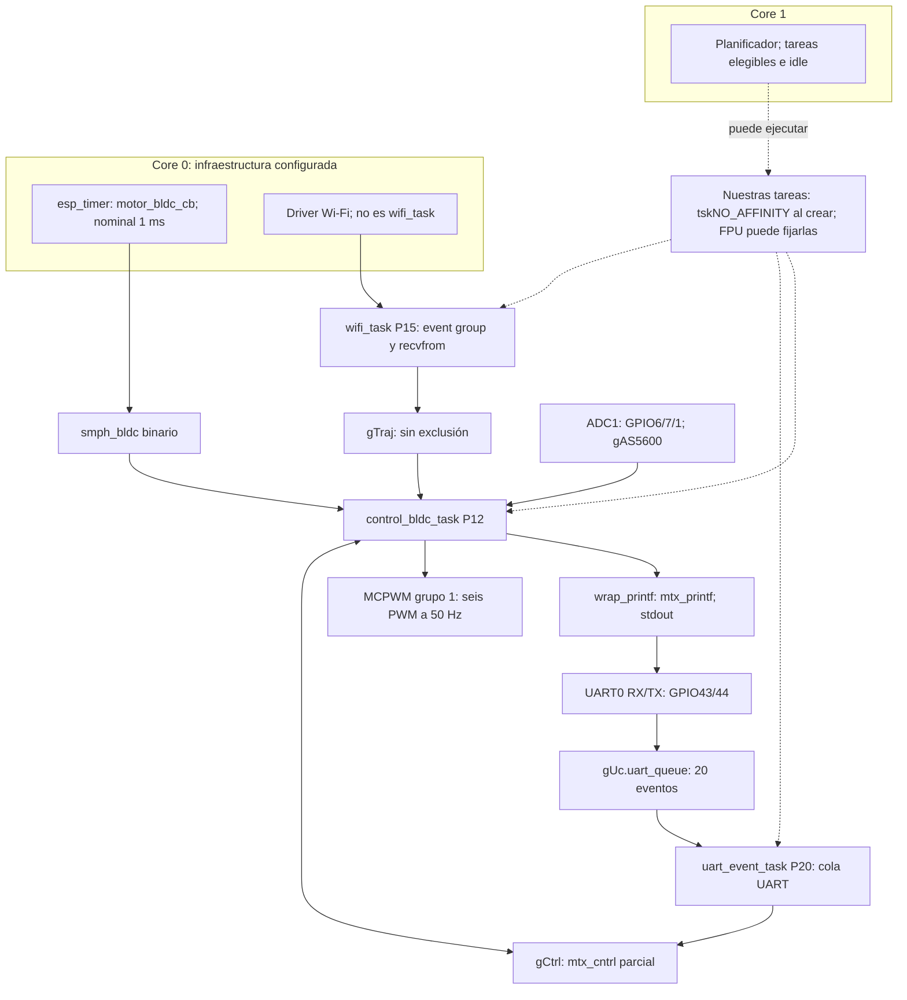
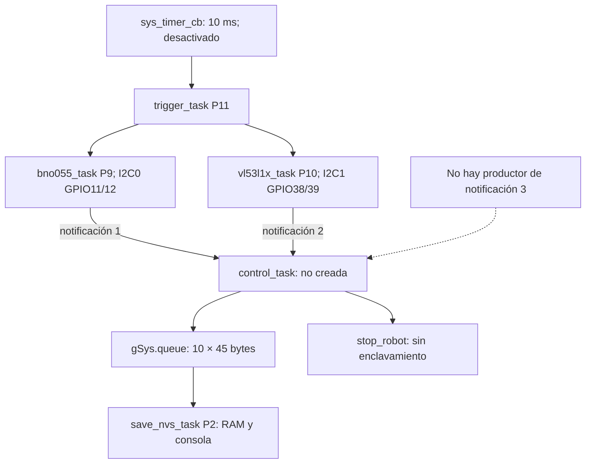

# Robot-Control — Striker2

## 1. Estructura del proyecto en el monorepo unificado

Desarrollamos **Robot-Control** como la capa de control de velocidad de nuestro robot omnidireccional de tres ruedas. Recibimos órdenes de traslación, giro y movimiento circular por Wi-Fi/UDP, calculamos las referencias de cada rueda mediante cinemática inversa y regulamos sus velocidades con controladores discretos de tipo PI. Medimos el ángulo con encoders AS5600 y filtramos la velocidad derivada con un Kalman escalar. Usamos ESP32-S3 con ESP-IDF y FreeRTOS de Espressif en dos núcleos.

La aplicación está en `firmware/apps/striker_v2/Robot-Control/` de [howlers-source](https://github.com/ravelasqvel/howlers-source/). Compartimos drivers con otras aplicaciones mediante `firmware/components/`, conservando las variantes `v2_striker2`. [Robot-Navigation](../Robot-Navigation/) extiende esta base hacia navegación; **en Robot-Control no tenemos seguimiento cerrado de posición, corrección de orientación ni protección activa por proximidad**.

### Estado de desarrollo

Documentamos el código de la revisión [`b3d268f7215e1f95b6c797be2b4b29c3f37cfff4`](https://github.com/ravelasqvel/howlers-source/tree/b3d268f7215e1f95b6c797be2b4b29c3f37cfff4), consultada el 29 de octubre de 2026. Nuestro `sdkconfig` fue generado con **ESP-IDF 5.4.0**. No presentamos esta revisión como lista para desplegar: tenemos marcadores de fusión guardados en `main/main.c`, riesgos de memoria en UART y errores pendientes en control y módulos auxiliares. Antes de energizar motores, debemos resolver los bloqueos P0 de la sección 7.

Los marcadores `<<<<<<< HEAD`, `=======` y `>>>>>>> …` forman parte del archivo versionado. Por eso podemos obtener un `git status` limpio y, aun así, no compilar. No son necesariamente un conflicto pendiente del índice. Una de las alternativas crea tareas antes de sus recursos y vuelve a crearlas al final; debemos dejar una sola creación después de completar la inicialización.

En este documento llamamos **camino activo** a las llamadas no comentadas que ejecutaríamos tras corregir ese arranque. Identificamos expresamente el código desactivado para que no confundamos intención de diseño con capacidad disponible. Hemos comprobado funciones matemáticas en host y reproducido un desbordamiento de la fusión con AddressSanitizer; todavía necesitamos una compilación integral de esta revisión corregida y pruebas de tiempo real en placa. Esos ensayos de host no validan el hardware ni los plazos del lazo.

### Organización actual

```text
howlers-source/
    firmware/
        apps/striker_v2/
            Robot-Control/
                CMakeLists.txt
                sdkconfig
                README.md
                main/
                    CMakeLists.txt
                    main.c
                    tasks.c
                    functions.c
                include/
                    types.h
                    tasks.h
                    functions.h
                docs/
                    HW Block Diagram.jpg
                    SW block diagram.jpg
                    Task Diagram.jpg
                    Control Block Diagram.jpg
            Robot-Navigation/
            Velocity-Control/
        components/
            platform_hal/v2_striker2/
                platform_esp32s3.c, platform_esp32s3.h
                platform_wifi_esp32s3.c, platform_wifi_esp32s3.h
            sensors/as5600/v2_striker2/
                as5600_lib.c, as5600_lib.h, as5600_defs.h
            sensors/bno055/v2_striker2/
                bno055.c, bno055.h, bno055_defs.h
            sensors/vl53l1x/v2_striker2/
                VL53L1X.c, VL53L1X.h, VL53L1X_types.h
            actuators/bldc_pwm/v2_striker2/
                bldc_pwm.c, bldc_pwm.h
            control/pid_lib/v2_striker2/
                control.c, control.h, senfusion.c, senfusion.h
            comms/uart_console/v2_striker2/
                uart_console.c, uart_console.h
    software/ground_station/
        striker2_udp_server/
            app.py
            templates/index.html
        striker2_server_test/
            app.py, robocup.py, obj_def.py, trajectory_functions.py
            templates/index.html
```

No tenemos `sdkconfig.defaults` ni `main/Kconfig.projbuild` en esta aplicación. Los proponemos en la sección 9. Tampoco existe actualmente la carpeta `firmware/components/actuators/led_status/v2_striker2/`, aunque CMake todavía la busca.

El CMake raíz declara `project(RoboCup_ESC)` y carga el sistema de compilación de ESP-IDF. En `main/CMakeLists.txt` incorporamos directamente fuentes con `file(GLOB ...)` dentro de un único `idf_component_register`; **no registramos cada carpeta central como un componente IDF independiente con `REQUIRES`**. Desde `main/`, `../../../../components/` apunta a `firmware/components/`.

| Carpeta central | Variable CMake | Función que incorporamos |
|---|---|---|
| `platform_hal/v2_striker2/` | `PLATFORM_SRCS` | ADC, I2C, GPIO y UART auxiliar; preparación NVS/red, estación Wi-Fi y eventos de conexión. |
| `sensors/as5600/v2_striker2/` | `AS5600_SRCS` | Configuración del encoder y conversión de su salida analógica a radianes. |
| `actuators/bldc_pwm/v2_striker2/` | `BLDC_PWM_SRCS` | Dos señales MCPWM por ESC: magnitud y selección de sentido. |
| `control/pid_lib/v2_striker2/` | `CONTROL_SRCS` | `control.c`: control discreto. `senfusion.c`: Kalman 1D, cinemática inversa y fusión multisensor auxiliar. |
| `sensors/bno055/v2_striker2/` | `BNO055_SRCS` | Driver IMU compilado; inicialización y tarea desactivadas. |
| `sensors/vl53l1x/v2_striker2/` | `VL53L1X_SRCS` | Driver ToF compilado; inicialización y tarea desactivadas. |
| `comms/uart_console/v2_striker2/` | `UART_CONSOLE_SRCS` | Driver UART0, buffer de recepción y cola de eventos. |
| `actuators/led_status/v2_striker2/` | `LED_SRCS` | Referencia obsoleta: la carpeta no existe y el glob queda vacío. No incorporamos un driver LED efectivo. |

`MAIN_SRCS` agrega los `.c` locales. Como también compilamos módulos de funciones desactivadas, sus errores de compilación pueden afectar al build aunque no creemos sus tareas. Debemos mantener separados “compilado”, “inicializado”, “ejecutado” y “usado para realimentar control”.

### Diagramas y antecedentes

Conservamos nuestros diagramas y aclaramos sus límites frente al código actual:


Representamos tres conjuntos idénticos ESC–BLDC–reducción planetaria–rueda, con lectura magnética AS5600, batería Li-Po **6S, 22,2 V nominales**, bus de potencia y una alimentación de 5 V hacia la placa. No conectamos la batería directamente a un GPIO ni a la alimentación lógica de 3,3 V. El diagrama no especifica relación de reducción ni todas las conexiones eléctricas: esas características deben validarse en el robot. La cinemática actual usa velocidad de rueda sin un factor explícito de reducción.


El bloque de PC denominado “UDP server” corresponde en la implementación a un **servidor HTTP Flask que envía UDP**. En el ESP32-S3 tenemos el socket receptor. Las flechas son conceptuales; no representan exclusión mutua sobre `gTraj` ni el orden exacto de cada instrucción.


Este diagrama conserva las tres tareas principales y la liberación nominal a 1 ms. No representa afinidades, tareas internas de IDF, bloqueos por consola ni funciones auxiliares desactivadas. UART recibe comandos; imprimimos la telemetría desde control.


Conservamos la intención de cerrar velocidad de ruedas mediante PI y encoders filtrados. La posición y orientación del cuerpo no se realimentan aquí. El modelo de primer orden empleado históricamente para sintonización no aparece como parámetros por motor en esta aplicación; documentamos la ley discreta que realmente ejecutamos en la sección 5.

Mantenemos como antecedentes del proyecto las pruebas de escalón, filtrado y seguimiento de comandos descritas en nuestra documentación previa. No disponemos de un informe de aceptación asociado a este commit que demuestre sus tiempos, estabilidad o seguridad. Para continuar el desarrollo, necesitamos repetir y registrar esas pruebas después de las correcciones.

Conservamos la autoría **© 2025 Striker2**, y los créditos presentes en los componentes: **MaverickST**, **Cristian David Araujo A.** en BNO055 y **Kevin Jimenez** en Wi-Fi. Nuestra documentación anterior remitía a un `LICENSE` raíz, pero ese archivo no existe en esta revisión; varias cabeceras indican `Unlicensed` y algunos subcomponentes tienen licencias propias. Debemos aclarar la licencia del conjunto; no atribuimos automáticamente a todo el monorepo la de un subcomponente.

## 2. Inicialización del sistema (`app_main`) y configuración de hardware

### 2.1. Pines, buses y parámetros

Definimos los pines de aplicación en `include/types.h`; completamos la configuración en las cabeceras y fuentes de los componentes centrales.

| Recurso | Configuración actual | Uso |
|---|---|---|
| Encoder 0 | OUT GPIO6 → ADC1 canal 5 | Realimentación activa. |
| Encoder 1 | OUT GPIO7 → ADC1 canal 6 | Realimentación activa. |
| Encoder 2 | OUT GPIO1 → ADC1 canal 0 | Realimentación activa. |
| ADC de encoders | Oneshot, 12 bits, `ADC_ATTEN_DB_12`, calibración curve fitting por canal | Un único handle ADC1; canales obtenidos con `adc_oneshot_io_to_channel`. Sin DMA. |
| I2C AS5600 | I2C1; SCL4, SDA5; 400 kHz; dirección `0x36` | Solo calibración/verificación, actualmente comentada. |
| BNO055 | I2C0; SCL11, SDA12; 400 kHz; dirección `0x29` | Desactivado. GPIO13 figura como reset, pero el driver no configura ni conmuta ese pin. |
| VL53L1X | I2C1; SCL38, SDA39; 400 kHz; dirección inicial `0x29` | Desactivados. GPIO41 figura como reset, sin secuencia XSHUT implementada. |
| ESC 0 | Magnitud GPIO17; sentido GPIO18 | Ambas son señales PWM. |
| ESC 1 | Magnitud GPIO8; sentido GPIO3 | Ambas son señales PWM. |
| ESC 2 | Magnitud GPIO46; sentido GPIO9 | Ambas son señales PWM. |
| MCPWM | Grupo 1; 1 MHz; 50 Hz; periodo 20 000 ticks | Tres timers, tres operadores, seis comparadores y seis generadores para los tres ESC. |
| UART0 | 115200 bit/s, 8N1, sin control de flujo | Pines por defecto retenidos con `UART_PIN_NO_CHANGE`: TX GPIO43, RX GPIO44 en la configuración por defecto del S3. |
| Buffers UART | RX 256 B, TX 256 B, lectura 128 B, cola de 20 eventos | Tenemos un defecto de límites en la lectura; ver sección 4. |
| Wi-Fi | Modo estación, SSID `Howlers - UdeA`, credencial en `WIFI_PASS` | IP obtenida por la interfaz por defecto; no configuramos una IP fija. |
| Socket del robot | UDP IPv4, `0.0.0.0:12345`, buffer 128 B | Recibimos hasta 127 bytes por llamada. |
| Geometría en `senfusion.h` | `WHEEL_RADIUS=0.03 m`, `ROBOT_RADIUS=0.16 m`, `DELTA=0.523598 rad` | Son las constantes utilizadas por la cinemática. |

GPIO3 y GPIO46 son pines de strapping: el circuito conectado debe respetar los niveles de arranque [E4]. No usamos LEDC ni conmutamos fases del BLDC desde el microcontrolador; delegamos la electrónica de potencia y la conmutación al ESC. La descripción histórica de motores con Hall no implica que leamos esas señales en el firmware.

Alimentamos conceptualmente los AS5600 a 3,3 V y asumimos OUT en 10–90 % de esa alimentación. El driver limita la tensión medida a 330–2970 mV y la convierte a 0–2π rad. La calibración del ADC corrige su conversión; **no programa el rango analógico del AS5600**.

### 2.2. Secuencia de arranque

Debemos resolver primero el bloque de fusión de `app_main`: conservar una única definición y una única llamada a `create_tasks()` después de inicializar todos sus recursos. La alternativa con espera inicial de 5 s evita la creación prematura; esa espera no reemplaza la validación del hardware.

Con ese orden, ejecutamos:

1. **Preparación en `init_drivers()`.** Copiamos parámetros de control; llamamos `senfusion_init(&gSenFusion,0.01)` y `control_init` para cada rueda con argumento `dt=0.001`. Este último argumento actualmente se ignora dentro del controlador. Instalamos UART0. Inicializamos, habilitamos y enviamos orden cero a cada ESC. Esperamos 3 s. No llamamos al driver LED ni a `bldc_calibrate`.
2. **Objetos del kernel.** `create_kernel_objects()` crea una cola de 10×45 bytes, cuatro mutexes y un semáforo binario vacío. Comprobamos sus handles, pero no deshacemos asignaciones anteriores si una posterior falla.
3. **Encoders.** `setup_as5600(100)` crea ADC1, configura sus tres canales y sus calibraciones, espera 1 s por canal y captura `angle_offset`. El argumento 100 no se utiliza. Si un canal falla, continuamos con los demás y podemos devolver éxito global; necesitamos corregirlo antes de armar motores.
4. **Rutas auxiliares.** Identificación, inicialización BNO055/VL53L1X, comprobación conjunta de sensores e `init_system()` permanecen comentadas.
5. **Tareas.** Creamos red P15, recepción UART P20 y control P12. Todavía no comprobamos los retornos de `xTaskCreate` ni implementamos limpieza completa al fallar.
6. **Red dentro de `app_network_task`.** `wifi_prepare()` inicializa NVS, red, event loop, interfaz estación y Wi-Fi. Si NVS indica falta de páginas o versión incompatible, la borra y reinicializa. `wifi_sta_init()` espera conexión mediante un event group; después creamos el socket UDP.
7. **Control dentro de `bldc_control_task`.** Creamos el timer periódico a 1000 µs, fijamos inicialmente referencias cero y programamos inmediatamente `calculate_trajectory_params(1,M_PI/2,30,50,true)`: traslación a 90°, 0,30 m/s, distancia nominal 0,50 m. Inicializamos los filtros y entramos al lazo.

**Tenemos movimiento automático al arrancar, sin esperar al operador ni a Wi-Fi.** Además, una orden recibida durante el arranque puede ser reemplazada por esa trayectoria inicial. Debemos incorporar armado explícito y una política de parada antes de usar esta aplicación fuera de un banco de pruebas.

### 2.3. Señales reales entregadas al ESC

En `bldc_init` creamos, por motor, un timer ascendente y un operador del grupo 1, dos comparadores y dos generadores. Las señales pasan a alto al comenzar el periodo y a bajo al alcanzar el comparador. Configuramos `update_cmp_on_tez=true`: los cambios se aplican al retorno del timer a cero [E8]. No sincronizamos explícitamente los tres timers entre sí.

`bldc_set_duty_motor` acepta una orden firmada `u` entre −100 y 100. La magnitud se transforma a una escala de milésimas de periodo:

$$
m=\operatorname{int}(50+0.7|u|),\qquad t_{\mathrm{alto}}=20m\;\mu s.
$$

Así, 0 produce **1000 µs**, 100 produce **2400 µs**, y el máximo actual del controlador, 60, produce **1840 µs**. Los límites `50/120` no son 50 %/120 % de PWM. La salida está cuantizada por la conversión a entero en pasos de 20 µs.

Para sentido usamos `reverse=70` si `u>=0` y `reverse=30` si `u<0`, que se convierten respectivamente en **1980 µs** y **1420 µs**. Los comentarios de esa función tienen los porcentajes invertidos respecto a las asignaciones; documentamos el comportamiento de las instrucciones. El significado físico de esos niveles debe verificarse en el ESC concreto.

La cabecera conserva un rango histórico del ESC de 1100–1940 µs y una calibración de máximo durante 6 s y mínimo durante 2 s. Nuestra configuración actual de 1000–2400 µs difiere de ese rango y la calibración está desactivada. Orden cero **mantiene un tren de pulsos de mínimo**, no deshabilita el timer. Debemos verificar aceptación del rango y parada efectiva con el ESC instalado.

`bldc_init` ignora retornos de numerosas funciones MCPWM y termina devolviendo `ESP_OK`. `init_drivers` tampoco valida sus retornos de habilitación/consigna. Consumimos todos los timers y operadores del grupo 1 que declara este target; duplicar tareas o inicializaciones no es inocuo.

### 2.4. Inicializaciones auxiliares previstas

En AS5600 declaramos modo normal, histéresis 2 LSB, salida analógica RR, filtro lento 8×, umbral rápido 6 LSB, watchdog desactivado y campo de frecuencia PWM 115 Hz. No usamos esa salida PWM para adquisición. La ruta comentada de calibración solo itera un sensor y, dentro de `AS5600_Calibrate`, también están comentadas las escrituras de configuración y posiciones: actualmente **verifica registros con assertions**, no aplica una calibración nueva. Las operaciones de quemado OTP están comentadas; no deben activarse como un paso rutinario de arranque.

Para BNO055 configuramos I2C a 400 kHz, unidades de aceleración m/s², giroscopio **grados/s** y Euler radianes. El comentario del driver que dice giroscopio rad/s no coincide con `BNO055_GYRO_UNIT_DPS`. El driver inicia NDOF; `setup_bno055` cambia a CONFIGMODE, escribe los siguientes offsets y termina en modo IMU:

```text
F7 FF CC FF C5 FF 8A 01 4E 01 5D 00 00 00 FF FF FF FF E8 03 AD 01
```

Debemos vincular esos offsets a la unidad física calibrada. `BNO055_Reset` solo intenta desinicializar I2C: la conmutación de reset está comentada y `rst_gpio` no se usa en la inicialización. La comprobación de 100 lecturas separadas 50 ms rechaza aceleración demasiado constante; puede rechazar un sensor sano inmóvil. Los reintentos no están acotados.

Para VL53L1X seleccionamos modo Short, presupuesto solicitado de 10 000 µs y periodo continuo de 10 ms. El driver acepta aritméticamente ese presupuesto, pero ignoramos retornos y no validamos rendimiento físico a esa tasa. Tres objetos comparten bus y dirección `0x29`, sin secuencia de XSHUT/direcciones únicas. El offset inicial `27*4` se sobrescribe después con una lectura de `MM_CONFIG__OUTER_OFFSET_MM` multiplicada por cuatro. No debemos describir esa secuencia como calibración individual completa.

## 3. Análisis de la estructura de tareas FreeRTOS

Creamos nuestras tareas con `xTaskCreate`, por lo que solicitamos **`tskNO_AFFINITY`**. Los stacks de ESP-IDF se expresan en **bytes**, no en palabras. El uso de FPU puede fijar una tarea al núcleo donde empieza a utilizarla; no asumimos que red y control se distribuyan automáticamente en núcleos distintos [E1].

| Estado | Nombre pasado a FreeRTOS | Función | Afinidad solicitada | Prioridad | Stack, bytes | Periodo o espera | Responsabilidad |
|---|---|---|---|---:|---:|---|---|
| Activa tras corregir arranque | `wifi_task` | `app_network_task` | `tskNO_AFFINITY` | 15 | 4096 | Event group durante conexión; luego `recvfrom` sin timeout | Inicializar Wi-Fi, recibir C1/C2/C3 y actualizar trayectoria. No es la tarea interna del driver Wi-Fi. |
| Activa | `uart_event_task` | `uart_event_task` | `tskNO_AFFINITY` | 20 | 4096 | `xQueueReceive(gUc.uart_queue,...,portMAX_DELAY)` | Procesar recepción UART y eventos de overflow. |
| Activa | `control_bldc_task` | `bldc_control_task` | `tskNO_AFFINITY` | 12 | 8192 | Semáforo binario `smph_bldc`; liberación nominal cada 1 ms | Leer encoders, filtrar velocidades, obtener referencias, calcular control, mandar PWM y emitir telemetría. |
| Creación comentada | `bno055_task` | `bno055_task` | `tskNO_AFFINITY` | 9 | 4096 | `ulTaskNotifyTake(pdTRUE,portMAX_DELAY)` | Leer IMU, obtener magnitud planar y emitir notificación índice 1. |
| Creación comentada | `vl53l1x_task` | `vl53l1x_task` | `tskNO_AFFINITY` | 10 | 4096 | Igual espera de notificación | Leer tres distancias; emitir índice 2. Publicación hacia supervisor incompleta. |
| Creación comentada | `trigger_task` | `trigger_task` | `tskNO_AFFINITY` | 11 | 3072 | Notificación desde timer general | Despertar IMU/láser; periodo previsto 10 ms, no 1 ms. |
| Creación comentada | `save_nvs_task` | `save_data_task` | `tskNO_AFFINITY` | 2 | 61440 | `xQueueReceive(gSys.queue,...,portMAX_DELAY)` | Guardar temporalmente en RAM e imprimir. No escribe NVS. |
| Definida, sin creación | No definido | `control_task` | No asignada | No asignada | No asignado | Notificaciones indexadas 1, 2 y 3, con `pdFALSE` | Supervisor general, parada por distancia y registro; falta emisor del índice 3. |
| Solo declarada en `tasks.h` | No definido | `as5600_task` | No asignada | No asignada | No asignado | No implementada | Conservamos declaración de una arquitectura anterior; el control actual lee los encoders directamente. |
| Definida en HAL, sin creación | No definido | `udp_server_task` | No asignada | No asignada | No asignado | `recvfrom` | Receptor auxiliar que solo imprime; no interpreta comandos. No lanzarlo junto al receptor de aplicación en el mismo puerto. |

`motor_identification_all` es una rutina bloqueante, no una tarea creada; si la habilitamos desde `app_main`, ocupa la tarea `main`. `uconsole_intr_handler` tampoco es una tarea: está definido, pero no lo registramos como ISR. Usa operaciones de lectura/log que no debemos trasladar a una ISR sin rediseñarlas. Los callbacks `motor_bldc_cb` y `sys_timer_cb` se ejecutan mediante `esp_timer`.

Además contamos con infraestructura IDF: `main` en Core 0 con stack 3584 B, servicio `esp_timer` en Core 0 con stack 3584 B, tareas idle de 1536 B por núcleo, tarea interna Wi-Fi fijada a Core 0, TCP/IP sin afinidad con stack 3072 B y event loop con stack 2304 B. Sus prioridades las determina IDF; no son las prioridades P15/P20/P12 de nuestra tabla. La opción `CONFIG_FREERTOS_USE_TIMERS=y` habilita timers FreeRTOS, pero no utilizamos `xTimerCreate` en nuestra aplicación.

Solicitamos en total 16 384 B de stack para las tres tareas activas, además de TCB, buffers, tareas de infraestructura y heap de drivers. `CONFIG_FREERTOS_MAX_TASK_NAME_LEN=16` puede truncar nombres en diagnósticos; la tabla muestra las cadenas originales de creación. El comentario “maximum priority” de `wifi_task` es incorrecto: UART tiene prioridad superior y también existen tareas internas de IDF.

## 4. Objetos del kernel, sincronización y tiempo real

### 4.1. Objetos que realmente usamos

Incluimos `FreeRTOS.h`, `task.h`, `semphr.h` y `queue.h` en `types.h`, y `event_groups.h` desde el HAL Wi-Fi. Usamos `esp_timer.h` para timers de alta resolución. No debemos confundir esos timers con objetos `TimerHandle_t` de FreeRTOS.

| Objeto | Creación y participantes | Uso y limitaciones |
|---|---|---|
| `gSys.smph_bldc` | `xSemaphoreCreateBinary`; callback motor → control | Despertar periódico. Solo conserva un evento pendiente. Identificación también lo utiliza si se habilita. |
| `gSys.mtx_cntrl` | Mutex; UART, red y control | Protege consignas y resets/cálculos seleccionados. `stop_robot` no participa en esa protección. |
| `gSys.mtx_printf` | Mutex; `wrap_printf` | Protege `vprintf` y `fflush` del wrapper. No engloba todos los `printf` ni `ESP_LOG*`. |
| `gSys.mtx_traj` | Mutex creado | No lo tomamos ni liberamos. `gTraj` queda desprotegida. |
| `gSys.mutex` | Mutex creado | Sin uso actual. |
| `gSys.queue` | `xQueueCreate(10,45)` | Cola por copia entre supervisor y registro, ambos desactivados. El tamaño fijo no coincide con el buffer del productor. |
| `gUc.uart_queue` | `uart_driver_install(...,20,...)` | Cola activa de 20 eventos UART; consumidor `uart_event_task`. |
| `s_wifi_event_group` | `xEventGroupCreate` en `wifi_sta_init` | Bits `WIFI_CONNECTED_BIT=BIT0` y `WIFI_FAIL_BIT=BIT1`; espera cualquiera, sin borrarlos al salir. Se elimina tras conexión/fallo. |
| `TaskHandle_t` de `gSys` | Seis campos | Solo asignamos activamente `task_handle_bldc_ctrl`. El handle del supervisor nunca se asigna. |
| Notificaciones directas | Timer general → trigger → IMU/láser → supervisor | Cadena desactivada; productor de índice 3 inexistente. Configuramos ocho entradas, pero eso no completa la lógica. |
| `gSys.timer_bldc` | `esp_timer_create`, nombre `bldc-ident` | Timer periódico activo nominal de 1000 µs; creado de nuevo también por identificación si la habilitamos. |
| `gSys.oneshot_timer` | `init_system`, nombre `sys-one-shot` | Inactivo: primero 3 s, después periodo de 10 ms. |
| Socket UDP | `socket/bind/recvfrom` | Recepción bloqueante a través de LwIP. No transportamos comandos por una cola propia hacia control. |

Pasamos `NULL` como `pvParameters` en las creaciones. Intercambiamos principalmente datos mediante globales: `gTraj`, `gCtrl`, `gMotor`, `gAS5600`, `gSys` y estructuras auxiliares. El mutex del PID no protege automáticamente el resto de esas estructuras. No usamos spinlocks, stream buffers ni message buffers en el camino de aplicación.

Usamos `vTaskDelay` para esperas de arranque y rutinas auxiliares; no hay `vTaskDelayUntil`/`xTaskDelayUntil`. En control bloqueamos sobre semáforo. En Wi-Fi creamos un event group real, aunque no aparezca directamente en `main/tasks.c`.

### 4.2. Tareas, núcleos y recursos compartidos

Mostramos la configuración guardada para la infraestructura y la ausencia de afinidad explícita de nuestras tareas. La distribución de ejecución de estas últimas debe medirse, especialmente después de usar FPU.



Core 0 también puede ejecutar nuestras tareas elegibles; no reservamos Core 1 exclusivamente para control. Los tres encoders comparten ADC1, pero los adquiere una sola instancia de control de forma secuencial. Las seis señales PWM pertenecen al mismo grupo MCPWM, con timers separados por motor.



Conservamos el [diagrama gráfico de tareas](<./docs/Task Diagram.jpg>) como vista general; estos dos diagramas explicitan los recursos y el estado de las rutas auxiliares.

### 4.3. Problemas de concurrencia, memoria y temporización

**Arranque y duplicación — P0.** Si conservamos la alternativa `HEAD`, ejecutamos tareas con `gUc.uart_queue`, `smph_bldc` y mutexes todavía nulos. Si alcanzamos la segunda creación, duplicamos lectores UART, lazos de control y preparación Wi-Fi. Sobrescribimos handles y competimos por `angle_prev`, PID y PWM. Debemos verificar retornos y crear cada propietario de recursos una sola vez.

**Trayectoria compartida — P1.** Escribimos `gTraj` desde `calculate_trajectory_params` y la leemos/modificamos desde `calculate_motor_setpoints` sin tomar `mtx_traj`. Podemos mezclar campos de órdenes distintas o perder el reinicio de `ktime`. Además, primero guardamos el número de protocolo 1/2/3 en `cmd` y después su enum 0/1/2: una lectura intermedia puede seleccionar el caso equivocado. El reset PID bajo `mtx_cntrl` no hace atómica la publicación de trayectoria. `volatile` no soluciona la coherencia del conjunto.

**Dos fuentes de consignas y parada no enclavada — P0/P1.** UART modifica referencias bajo mutex; control vuelve a calcularlas desde la trayectoria y las sobrescribe. No tenemos un modo manual persistente. `stop_robot` escribe PID/PWM sin mutex, no invalida trayectoria ni detiene `timer_bldc`; al reactivar el supervisor, una orden local calculada antes de la parada puede volver a aplicarse después. Necesitamos un propietario único de actuadores y una política de rearme.

**Contexto de callbacks — P1.** No especificamos `dispatch_method`; con nuestra configuración usamos la tarea `esp_timer` de Core 0, no despacho ISR [E2]. Sin embargo, llamamos `xSemaphoreGiveFromISR` y `vTaskNotifyGiveFromISR`. Debemos alinear API y contexto; descomentar `portYIELD_FROM_ISR` no corrige un callback de tarea. Si elegimos despacho ISR, tendremos que habilitarlo, seleccionar el método y usar `esp_timer_isr_dispatch_need_yield()` cuando corresponda. No podemos trasladar logs o funciones potencialmente bloqueantes a ISR.

**Pérdida de activaciones y tiempo de muestra — P1.** `smph_bldc` solo retiene una liberación; ignoramos el resultado del `give`. Si el trabajo se retrasa, perdemos periodos o procesamos despertares muy próximos. Calculamos velocidad suponiendo 1 ms y avanzamos trayectoria por número de iteraciones, sin timestamps reales. Eso cambia escala de velocidad y duración física. Además, actualizamos comparadores a 50 Hz: las escrituras intermedias a 1 kHz pueden sustituirse antes de aplicarse. Debemos medir toda la cadena ADC→control→pulso, no solo el timer.

**Expropiación y salida serial — P1.** UART P20 y red P15 pueden desplazar a control P12 cuando compiten por un núcleo elegible. Imprimimos dentro del lazo cada diez iteraciones y podemos bloquear en `mtx_printf`/stdout. La herencia de prioridad del mutex no reduce el tiempo de transmisión [E1]. No hemos demostrado una inversión no acotada ni un deadlock; sí mantenemos bloqueos y jitter sin acotar. Los retardos relativos auxiliares incluyen tiempo de trabajo adicional; no deben usarse para afirmar periodicidad exacta.

**Recepción UART — P0.** En `uconsole_read_data`, reservamos 128 bytes, consultamos todo lo acumulado en RX y lo leemos sin limitar `uc->len`. Con 128 bytes, el terminador `uc->data[uc->len]` ya queda fuera; con más, también desbordamos durante lectura. Además pasamos `(size_t*)&uc->len`, aunque `len` es `uint16_t`: en ESP32-S3 escribimos cuatro bytes sobre un campo de dos y alcanzamos `uart_num`/relleno. No validamos el número realmente leído, ni acumulamos/reensamblamos tramas. Si `malloc` falla, dejamos una tarea que puede usar `data=NULL`. Debemos corregir esto antes de probar comandos por UART.

**Wi-Fi y estado estático — activo y condicional.** `wifi_prepare` contiene `static bool initialized` sin exclusión; dos inicializaciones concurrentes pueden entrar a la vez. Compartimos `s_wifi_event_group`, `retry_num` y `s_ip` en el módulo. Durante una única conexión, el event group comunica el resultado correctamente, pero al terminar **desregistramos los handlers y eliminamos el grupo**. Así no mantenemos la lógica de reconexión tras una pérdida posterior de enlace. No debemos confundir los 20 reintentos de conexión inicial con recuperación permanente. `xEventGroupCreate` tampoco se comprueba.

**I2C y múltiples instancias — latente.** `i2c_init` e `i2c_init_new_device` usan un `static i2c_master_dev_handle_t dev_handle` local. Si dos tareas inicializan dispositivos concurrentemente, una puede copiar a su estructura el handle escrito por la otra. Debe ser automático o estar protegido por el diseño de inicialización. Compartir bus no exige necesariamente un mutex adicional sobre toda transacción: debemos distinguir garantías del driver IDF de la coherencia de nuestras operaciones compuestas [E9]. El mismo I2C1 figura con GPIO4/5 para AS5600 y GPIO38/39 para VL53L1X; un mutex no resuelve esa incompatibilidad de cableado/configuración.

**Estado compartido en VL53L1X — latente.** En `VL53L1X.h` declaramos estáticos mutables `calibrated`, `saved_vhv_init`, `saved_vhv_timeout`, `timeout_start_ms`, `io_timeout` y `did_time_out`. Dentro del driver los comparten los tres sensores. Incluso con lecturas secuenciales, calibrar el primero puede hacer que los siguientes omitan su calibración manual. En varias tareas tendríamos además carreras. Por estar en una cabecera, otras unidades de traducción reciben copias diferentes. `io_timeout=0` desactiva el timeout lógico, de modo que algunas esperas pueden no terminar.

**Notificaciones auxiliares — latente.** No creamos `control_task`, su handle sigue nulo y nadie produce el índice 3. Activar solo las tareas de sensores no completa el flujo. `pdTRUE` en trigger/sensores descarta cuentas acumuladas; `pdFALSE` en supervisor consume una por índice. Sin timestamps/secuencia, podemos combinar mediciones de épocas distintas. Ocho entradas de notificación disponibles no corrigen esos problemas.

**Cola de registro — latente.** `control_task` crea un VLA con una cadena corta, pero `xQueueSendToBack` copia 45 bytes: leemos más allá de ese objeto. Ignoramos cola llena. `save_data_task` usa `strlen` sin longitud fiable y escribe `buffer[gSys.cnt_sample]` antes de validar el índice, mientras timer y consumidor modifican el contador. El buffer tiene 1001×45 = **45 045 bytes en stack**. Podemos introducir huecos, desbordamiento y carreras; el nombre `save_nvs_task` no describe persistencia real.

**Fallos de driver que no son carreras.** Las lecturas ADC activas son secuenciales; no afirmamos una carrera solo por compartir unidad. Sí usamos `ESP_ERROR_CHECK` en lectura calibrada, que aborta ante error en vez de publicar una muestra inválida. En I2C convertimos `I2C_TIMEOUT_MS/portTICK_PERIOD_MS` y lo pasamos a APIs cuyo timeout ya está en milisegundos [E9]: a 1 kHz coincide accidentalmente; a 100 Hz se convierte en 10 ms, no 100 ms. `i2c_deinit` intenta borrar un bus sin retirar primero sus dispositivos. En los wrappers de registros de 16 bits ignoramos errores. Estas fallas deben corregirse antes de reactivar sensores.

## 5. Módulos de estimación, cinemática y control

### 5.1. Ángulo, velocidad y Kalman escalar

En `AS5600_ADC_GetAngle` convertimos la tensión calibrada del ADC a ángulo, suponiendo salida analógica RR del encoder:

$$
V_c=\operatorname{sat}_{[330,2970]}(V_{\mathrm{mV}}),\qquad
\theta=2\pi\frac{V_c-330}{2970-330}.
$$

Si no tenemos calibración ADC o no seleccionamos `AS5600_OUTPUT_STAGE_ANALOG_RR`, devolvemos −1. El consumidor no comprueba ese error antes de calcular velocidad. Además, saturar tensión puede ocultar desconexiones o saturación eléctrica: necesitamos un indicador de validez independiente del ángulo.

En `calculate_motor_speed` usamos `raw=angle_offset-angle`, con inversión de signo respecto a la lectura. Restamos `angle_prev`, corregimos una vuelta sumando/restando 2π cuando la diferencia sale de [−π,π] y multiplicamos por `SAMP_RATE_MOTOR_HZ=1000`:

$$
\Delta\theta_k=\operatorname{wrap}_{[-\pi,\pi]}(\mathrm{raw}_k-\mathrm{raw}_{k-1}),\qquad
\omega_{\mathrm{med},k}=1000\Delta\theta_k.
$$

Esta reconstrucción requiere menos de media vuelta entre muestras válidas. No calculamos el tiempo transcurrido real. Las lecturas de las tres ruedas son secuenciales y tienen un pequeño desfase entre sí; debemos medirlo si sincronizamos estimación del cuerpo.

Inicializamos un filtro independiente por rueda mediante `kalman1D_init`, con estimación `x=0`, covarianza `P=1`, ruido de proceso `Q=0.001` y ruido de medida `R=1.12`. En cada muestra aplicamos:

$$
P_k^-=P_{k-1}+Q,\quad K_k=\frac{P_k^-}{P_k^-+R},\quad
\hat\omega_k=\hat\omega_{k-1}+K_k(\omega_{\mathrm{med},k}-\hat\omega_{k-1}),\quad
P_k=(1-K_k)P_k^-.
$$

Usamos un modelo escalar de evolución aleatoria de velocidad, no el modelo identificado del motor. `Q` y `R` representan covarianzas; su ajuste depende de unidades y frecuencia de muestra. Filtrar reduce ruido, pero también introduce retardo y modifica la dinámica del lazo. Debemos comparar ruido, respuesta transitoria y desfase, no evaluar solo la suavidad de la curva.

### 5.2. Cinemática inversa realmente implementada

En `calc_invkinematics`, dentro de `senfusion.c`, transformamos velocidad del cuerpo `(vbx,vby,wb)` en referencias de rueda:

$$
\begin{aligned}
\omega_1&=\frac{-v_{bx}\sin\delta-v_{by}\cos\delta+R_b\omega_b}{r_w},\\
\omega_2&=\frac{v_{bx}+R_b\omega_b}{r_w},\\
\omega_3&=\frac{-v_{bx}\sin\delta+v_{by}\cos\delta+R_b\omega_b}{r_w}.
\end{aligned}
$$

Usamos `r_w=WHEEL_RADIUS=0.03 m`, `R_b=ROBOT_RADIUS=0.16 m` y `δ=DELTA=0.523598 rad` (aproximadamente 30°). Las velocidades lineales están en m/s, la del cuerpo en rad/s y las ruedas en rad/s. El comentario de la cabecera llama “diameter” a `ROBOT_RADIUS`, pero en estas ecuaciones lo usamos como brazo de palanca: debemos confirmar la distancia centro–rueda real. No incluimos una relación de reducción aunque aparezca un factor `n/r` en comentarios históricos.

Para `(vbx,vby,wb)=(0,0.30,0)`, obtenemos aproximadamente `(−8.6603,0,+8.6603) rad/s`; para giro puro, todas las referencias valen `(0.16/0.03)wb`. Los índices 0, 1 y 2 de `gCtrl` corresponden a las salidas 1, 2 y 3 de la función. Debemos comprobar en banco el orden físico de ruedas y los signos de encoder/ESC antes de cerrar el lazo.

### 5.3. Generación de trayectorias

`parse_command` convierte grados a radianes y llama `calculate_trajectory_params`. Después, `calculate_motor_setpoints` evalúa referencias por índice de muestra `k`, no por posición observada. Para frecuencia nominal `f_s=1000 Hz`:

| Orden | Parámetros internos | Referencias del cuerpo | Duración nominal |
|---|---|---|---|
| C1, recta | `v=speed/100`, `d=distance/100`, `α` en rad | `vbx=v cos α`, `vby=v sin α`, `wb=0` | `N=int((distance/speed)f_s)` usando ambas magnitudes de entrada en cm y cm/s. |
| C2, giro | `ω=speed` en rad/s; `α` en rad | `vbx=vby=0`, `wb=ω` | `N=int((α/ω)f_s)`. |
| C3, círculo | `r=radius/100`, `v=speed/100`, `ω=v/r` | `vbx=−rω sin(ωk/f_s)`, `vby=rω cos(ωk/f_s)`, `wb=0` | `N=uint32_t((αr/v)f_s)`. |

En C3 mantenemos orientación deseada constante (`wb=0`); no ordenamos que el robot apunte tangencialmente. Guardamos `dir` al recibir CW/CCW, pero **no lo usamos en las ecuaciones**: con los mismos valores numéricos ambos comandos producen la misma trayectoria. No validamos velocidades/radios cero, valores no finitos ni duraciones negativas o fuera de rango antes de convertirlas a enteros.

Cuando `ktime>=k_duration`, devolvemos referencias cero y reseteamos los tres PID en **cada iteración posterior**. No medimos si alcanzamos la posición final. La duración de una maniobra depende del número de iteraciones efectivamente ejecutadas; pérdidas de activación la alargan. La deriva de orientación, el deslizamiento y errores de radio/geometría no se corrigen mediante esta generación temporal.

### 5.4. Ley de control activa y saturación

Configuramos para cada rueda `Kp=2.1167`, `Ki=25.0639`, `Kd=0`, límites integrales ±200 y salida ±60. Sin embargo, en `bldc_control_task` llamamos **`control_calc_pid_z`**, con `order=1` y coeficientes `a1=1.53`, `a0=−1.50`, `b1=1`, `b0=−1`. Por tanto, la ley que realmente ejecutamos es:

$$
e_k=\omega_k^*-\hat\omega_k,\qquad
v_k=\frac{a_1e_k+a_0e_{k-1}-b_0v_{k-1}}{b_1}
=v_{k-1}+1.53e_k-1.50e_{k-1},\qquad
u_k=\operatorname{sat}_{[-60,60]}(v_k).
$$

`prev_u1` guarda **`v_k` antes de saturarlo**. No tenemos anti-windup en esta ruta y los límites `min_integral/max_integral` no intervienen. Mantener error mientras saturamos acumula estado interno, incluso si la salida física ya no aumenta. El reset tampoco constituye anti-windup durante una maniobra.

Sin saturación, la transferencia es `(1.53−1.50z⁻¹)/(1−z⁻¹)`. Si la interpretamos como PI incremental con integración rectangular hacia atrás, equivale a `Kp=1.50` y `Ki·Ts=0.03`; con `Ts=0.001 s`, `Ki=30 s⁻¹`. Esa equivalencia algebraica **no corresponde a los campos `Kp=2.1167` y `Ki=25.0639`**, que permanecen sin uso en el camino activo. `control_init` recibe `dt`, pero no lo guarda ni lo utiliza; el periodo está implícito en los coeficientes.

La alternativa `control_calc_pid`, que no llamamos desde el lazo activo, implementa una forma posicional:

$$
I_k=\operatorname{sat}_{[-200,200]}(I_{k-1}+e_k),\qquad
u_k=\operatorname{sat}_{[-60,60]}\left(K_pe_k+K_d(e_k-e_{k-1})+K_iI_k\right).
$$

Aquí tampoco multiplicamos la integral por `dt` ni dividimos la derivada por `dt`; no podemos intercambiar ambas funciones usando las mismas ganancias sin revisar su discretización. También tenemos una rama `order=2` con dos errores y dos salidas previas, pero no la seleccionamos. Las funciones devuelven el esfuerzo calculado; no actualizan automáticamente `ctrl->output`.

Comprobamos la rama activa con un ensayo de host: para un primer error 100, obtenemos salida 60 y memoria interna 153. Después de 101 muestras con ese error y una con error cero, la memoria todavía vale 303 y la salida sigue en 60. Es una comprobación del algoritmo y del riesgo de windup; no es una prueba de estabilidad de la planta real.

### 5.5. Fusión auxiliar de posición y velocidad

Inicializamos `gSenFusion`, pero **no llamamos `senfusion_predict` ni `senfusion_update` en el camino activo**. Mantenemos este módulo como trabajo pendiente, separado del Kalman escalar que sí filtra las ruedas.

El modelo de dos estados usa, por la estructura de las medidas, posición y velocidad de un eje; no representa por sí solo una pose móvil `(x,y,θ)`:

$$
x_k^-=Ax_{k-1}+Bu_k,\quad P_k^-=AP_{k-1}A^T+Q,
$$

$$
A=\begin{bmatrix}0.9955&0.00931\\-0.8805&0.8638\end{bmatrix},\quad
B=\begin{bmatrix}8.81\cdot10^{-5}\\0.0172\end{bmatrix},\quad
H=\begin{bmatrix}1&0\\1&0\\0&1\end{bmatrix},\quad
z=\begin{bmatrix}p_{enc}\\p_{lidar}\\v_{imu}\end{bmatrix}.
$$

Integramos `v_imu=v_imu_prev+a_imu·dt`. Inicializamos `P=I` y, con `dt=0.01` y factor de ruido de proceso 1:

$$
Q=\begin{bmatrix}\tfrac14dt^4&\tfrac12dt^3\\\tfrac12dt^3&dt^2\end{bmatrix}.
$$

La actualización pretende aplicar `S=HP⁻Hᵀ+R`, `K=P⁻HᵀS⁻¹`, `x=x⁻+K(z−Hx⁻)` y `P=(I−KH)P⁻`. Resolvemos el sistema mediante LU sin pivoteo ni control de singularidad. No regeneramos `A/B` al cambiar `dt`, por lo que tampoco podemos cambiar la tasa conservando automáticamente el mismo modelo físico.

Tenemos defectos concretos que impiden activar esta implementación sin corregirla:

- `matrixMultiplication(3,2,2,H,x_pred,y)` declara dos columnas para `x_pred[2][1]` y `y[3][1]`. La dimensión de salida debería ser una columna. Hemos reproducido un desbordamiento de stack con AddressSanitizer al ejecutar `senfusion_update` en host.
- Inicializamos `R[2][2]` con el cuadrado de `sqrt(k)·0.0148·dt`, pero durante actualización asignamos directamente esa desviación, sin elevarla al cuadrado. Mezclamos desviación estándar y varianza; además, en `k=0` atribuimos ruido cero a esa medida.
- El valor `sigma_p_enc=0.000784 m` equivale a **784 µm**, no a 7.84 µm como dice el comentario. Su varianza es `6.14656e−7 m²`; para láser usamos `0.02²=0.0004 m²`.
- No hemos conectado medidas sincronizadas, definido una referencia espacial común para distancias ToF ni compensado orientación/gravedad para integrar aceleración.

### 5.6. Identificación y máquina de estados prevista

Conservamos `motor_identification_all` para aplicar escalones y registrar tres velocidades. Adquirimos 5000 muestras por ensayo; el registro de una orden entera y tres `float` ocupa aproximadamente **80 kB** en la ABI de 32 bits. Repetimos secuencialmente para los tres motores, no excitamos los tres a la vez. La secuencia nominal de órdenes es:

| Intervalo, s | Orden |
|---|---:|
| 0–0.5 | 7 |
| 0.5–1.5 | 20 |
| 1.5–2.5 | 30 |
| 2.5–3.0 | 0 |
| 3.0–3.5 | −7 |
| 3.5–4.5 | −20 |
| 4.5–5.0 | −30 |

La rutina usa el mismo semáforo motor, crea su timer y no completa su eliminación. Debemos ejecutarla en un modo exclusivo, sin competir con control, revisar el heap disponible y conservar timestamps reales antes de identificar una planta. Las pruebas históricas de escalón motivaron la sintonización; no tenemos aquí una identificación automática ni parámetros independientes comprobados por rueda.

El supervisor auxiliar se diseñó alrededor de `INIT_BLDC_STEP_1`, `CHECK_SENSORS`, `SYS_SAMPLING_EXP`, `SYS_SAMPLING_CONTROL` y `NONE`. `init_system` programa un disparo a 3 s; después prevemos un periodo de 10 ms. Las ramas experimentales cuentan 1000 muestras (10 s nominales) y control 500 (5 s nominales). No completamos todas las transiciones, y `CHECK_SENSORS` depende de banderas de tareas que hoy no creamos. Detener el timer general no detiene el timer del lazo BLDC. `verify_sensors` devuelve éxito con comprobaciones decisivas comentadas; su contador `uint8_t` frente a `num_checks` de 32 bits puede no terminar para valores superiores a 255. No debemos usar esa función como condición fiable de armado.

## 6. Uso real de sensores y módulos auxiliares

Nuestra intención es conservar una base de velocidad ampliable a navegación. Actualmente cerramos el lazo con encoders, y dejamos IMU, proximidad y fusión sin conectar. La siguiente tabla distingue esa intención del comportamiento ejecutable tras corregir el arranque.

| Módulo | Qué inicializamos/ejecutamos | Qué aportamos hoy al control | Limitación e impacto físico |
|---|---|---|---|
| AS5600 ×3 | ADC y filtros activos; configuración I2C/OTP desactivada | Velocidad individual de rueda | Dependemos del rango analógico ya programado y del cableado. No detectamos válidamente todos los errores ni corregimos deslizamiento. |
| Kalman escalar | Tres filtros activos | Velocidad suavizada para los tres controladores | Reduce ruido y añade retardo; no estima pose ni fusiona IMU. |
| BNO055 | Driver compilado; setup/tarea desactivados | Ninguno | No compensamos yaw ni cerramos orientación. El robot puede desviarse aunque cada rueda siga su velocidad. |
| VL53L1X ×3 | Driver compilado; setup/tarea desactivados | Ninguno | No tenemos detección de obstáculos ni parada efectiva por distancia. |
| Fusión `senfusion` | Estructura inicializada; predict/update sin llamadas activas | Ninguno | No estimamos posición global con este módulo. Tiene un desbordamiento que debemos corregir antes de usarlo. |
| Supervisor y registro | Tareas no creadas | Ninguno | No se ejecuta la máquina de seguridad prevista ni se guarda telemetría en NVS. |
| LED de estado | Ruta CMake inexistente; inicialización comentada | Ninguno | No contamos con señalización luminosa fiable de armado/fallo. |

En la tarea BNO055 prevista llamamos `BNO055_ReadAll`, que lee aceleración con gravedad, mientras la rutina de setup usa `BNO055_ReadAll_Lineal`. Calculamos una magnitud planar, que elimina el signo de los ejes; eso no equivale a aceleración longitudinal firmada ni permite integrar correctamente un movimiento bidireccional. Tampoco usamos yaw en la cinemática. Debemos definir ejes, marco de referencia, compensación de gravedad y tratamiento de sesgos antes de introducir realimentación inercial.

En VL53L1X tenemos tres problemas adicionales a la inicialización común. `VL53L1X_readDistance` devuelve `ranging_data.range_mm`, pero el supervisor consulta `dist_mm`, que no actualizamos en esa ruta: con objetos globales inicialmente a cero puede interpretar obstáculo inmediato. La referencia previa de distancia de la tarea tampoco se actualiza correctamente. En `VL53L1X_updateDSS`, convertimos el arreglo `TARGET_RATE` a entero mediante `(uint32_t)TARGET_RATE`, por lo que usamos su dirección de memoria en vez de combinar los dos bytes del valor objetivo.

La función disponible para cambiar dirección se llama `setAddress`. Actualiza el registro del sensor y un campo de nuestra estructura, pero no reconfigura el handle de dispositivo del nuevo driver I2C de IDF. No basta con descomentar la llamada histórica `VL53L1X_setAddress`: ese nombre no corresponde a la función actual, y necesitamos actualizar también el dispositivo registrado en el bus.

No usamos TM151, VL6180X ni APDS9960 en esta aplicación. Que existan otros sensores en el monorepo o en proyectos anteriores no implica que formen parte de este lazo.

## 7. Tareas pendientes y alternativas a evaluar

Usamos **P0** para bloqueos de compilación, corrupción de memoria o movimiento sin control de armado; **P1** para corrección funcional y temporal; **P2** para mantenibilidad y caracterización. Las alternativas son decisiones de diseño por comparar, no correcciones ya implementadas. En módulos desactivados, su prioridad aumenta antes de habilitarlos.

1. **P0 — Resolver arranque y comprobar recursos.** **Problema:** marcadores versionados, creación prematura/duplicada y retornos ignorados. **Alternativa A:** inicialización secuencial en `app_main`, con una única creación de tareas al final y liberación ordenada al fallar. **Alternativa B:** tarea de inicialización con estado explícito y publicación de disponibilidad antes de habilitar consumidores. **Medir/comparar:** complejidad, tiempo de arranque, heap residual tras fallos inyectados y posibilidad de reiniciar periféricos. En ambas debemos eliminar marcadores, validar todos los handles y evitar que se arme un conjunto parcialmente inicializado.

2. **P0 — Corregir recepción UART.** **Problema:** buffer de 128 B desbordable, conversión incorrecta `uint16_t*→size_t*`, número leído ignorado y falta de delimitación. **Alternativa A:** parser incremental sobre buffer fijo acotado con delimitador y descarte explícito de tramas largas. **Alternativa B:** stream/ring buffer y consumidor que reensamble tramas con longitud validada. **Medir/comparar:** RAM, bytes/s sostenibles, latencia, recuperación tras fragmentación/concatenación y carga CPU. En ambos usamos variables del tipo correcto, comprobamos `malloc`/lectura y probamos límites 127, 128 y más bytes.

3. **P0 — Armado, parada y arbitraje de fuentes.** **Problema:** trayectoria automática, UART sobrescrita y `stop_robot` sin enclavamiento. **Alternativa A:** máquina de estados DISARMED/ARMED/FAULT en la tarea propietaria de motores, con órdenes por cola. **Alternativa B:** tarea supervisora con canal de parada prioritario y estado compartido protegido, verificado antes de cada escritura PWM. **Medir/comparar:** latencia máxima de parada hasta pulso efectivo, tiempo de rearme y comportamiento ante órdenes concurrentes, bloqueo de red o sensor inválido. Definir prioridad entre UART/UDP y parada; el circuito físico de inhibición debe ser independiente de la recepción de comandos.

4. **P1 — Publicar trayectorias coherentes.** **Problema:** lectura/escritura simultánea de `gTraj` y reset de `ktime`. **Alternativa A:** cola de comandos completos; control es dueño exclusivo de trayectoria y contador. **Alternativa B:** copiar una estructura completa bajo `mtx_traj`, manteniendo el cómputo fuera del bloqueo. **Alternativa C:** doble buffer con publicación/versionado protegido y reglas explícitas de propiedad. **Medir/comparar:** coste de copia, SRAM, bloqueo máximo, edad de comando y política ante ráfagas. Un event group puede avisar disponibilidad, pero no hace atómico el contenido de una estructura.

5. **P1 — Definir la temporización y el contexto de timer.** **Problema:** APIs FromISR en callback de tarea, pérdidas con semáforo binario y `dt` supuesto. **Alternativa A:** mantener `ESP_TIMER_TASK`, usar API de tarea y notificación contadora con timestamps/contador de atrasos. **Alternativa B:** despacho ISR compatible o GPTimer con trabajo mínimo y despertar directo. **Alternativa C:** tarea periódica con `xTaskDelayUntil`, si la resolución y el jitter medidos son suficientes. **Medir/comparar:** latencia liberación→ADC, WCET, CPU, perdidas y p99/máximo de jitter. Decidir si un atraso cancela, salta muestras o cambia `dt`; acumular avisos no recupera muestras físicas que nunca adquirimos.

6. **P1 — Alinear control con ESC y eliminar windup.** **Problema:** cálculo a 1 kHz, PWM a 50 Hz, historia no saturada y ganancias duplicadas. **Alternativa A:** conservar control discreto y diseñar anti-windup por integración condicional/tracking. **Alternativa B:** usar PI posicional con `dt` explícito y back-calculation. **Alternativa C:** estructura multirrate: adquisición rápida y actualización de actuador sincronizada a su tasa admitida. **Medir/comparar:** estabilidad, sobreimpulso, recuperación de saturación, retardo, coste CPU y respuesta de cada ESC. Identificar la planta con la misma tasa y rango de pulsos que usaremos; no aumentar PWM sin comprobar el protocolo físico del ESC.

7. **P1 — Separar telemetría del plazo de control.** **Problema:** `printf/fflush` y mutex en la ruta crítica. **Alternativa A:** cola de registros binarios fijos hacia una tarea de transmisión. **Alternativa B:** ring buffer con descartes contados. **Alternativa C:** snapshot de última muestra con decimación, aceptando pérdida de historial. **Medir/comparar:** SRAM, carga UART, tiempo de bloqueo y muestras perdidas. Añadir timestamps reales, número de secuencia y una política ante consumidor lento.

8. **P1 — Validar comandos y recuperar Wi-Fi.** **Problema:** `atof` permisivo, división por cero, falta de ACK/timeout y handlers eliminados tras conectar. **Alternativa A:** protocolo textual estricto con `strtof`, validación completa, secuencia/ACK y heartbeat sobre UDP. **Alternativa B:** mensajes binarios versionados con longitud/tipo y confirmación de aplicación. **Alternativa C:** transporte TCP con framing explícito, manteniendo plazo de vigencia de la orden. **Medir/comparar:** latencia y bloqueo ante pérdida, CPU, buffers, facilidad de depuración e interoperabilidad con Flask. Mantener manejadores de reconexión y definir qué hace el robot cuando pierde enlace; recibir una orden no debe equivaler automáticamente a armar.

9. **P1 — Corregir semántica de trayectorias.** **Problema:** ignoramos CW/CCW, duración por iteraciones y fin sin posición medida. **Alternativa A:** generación temporal con reloj monotónico, signo de giro explícito y límites de aceleración. **Alternativa B:** seguimiento de pose con odometría/IMU y saturación coordinada de ruedas. **Medir/comparar:** error final, deriva angular, suavidad, coste de estimación y comportamiento ante deslizamiento. La primera opción conserva control de velocidad; la segunda exige sensores y un modelo de marcos de referencia validados.

10. **P1 — Validar adquisición y calibración de encoders.** **Problema:** supuesto RR no programado, fallos ADC ocultos y diferenciación con tiempo fijo. **Alternativa A:** mantener ADC oneshot con validación de rango, timestamp por rueda y calibración reproducible. **Alternativa B:** lectura digital I2C, resolviendo antes las tres direcciones iguales mediante multiplexor o arquitectura de buses. **Alternativa C:** evaluar lectura de salida PWM con captura hardware. **Medir/comparar:** resolución efectiva, ruido, latencia, carga de buses/CPU y recursos de pines. Separar calibración ADC de configuración del sensor; no quemar OTP durante ensayos rutinarios.

11. **P1 al activar sensores — Reorganizar I2C y VL53L1X.** **Problema:** un bus con dos pinouts, tres ToF en `0x29`, estado estático compartido, errores ignorados y DSS incorrecto. **Alternativa A:** tarea propietaria de sensores, XSHUT individual y direcciones únicas con handles coherentes. **Alternativa B:** multiplexor I2C y estado completo por instancia. **Alternativa C:** varios consumidores con exclusión para secuencias compuestas, tras resolver topología y direccionamiento. **Medir/comparar:** tiempo de ciclo de tres sensores, bloqueo máximo, pines/BOM, RAM y recuperación de un dispositivo averiado. Corregir `TARGET_RATE`, unidades de timeout, limpieza de dispositivos y publicación de `dist_mm` en cualquier arquitectura.

12. **P1 al activar fusión — Reparar y validar el estimador.** **Problema:** desbordamiento matricial, varianzas inconsistentes, modelo fijo y medidas sin sincronizar. **Alternativa A:** conservar el filtro de dos estados para un experimento unidimensional, con matrices tipadas y pruebas numéricas. **Alternativa B:** diseñar estimación de pose planar con odometría y yaw; integrar ToF solo con geometría de observación definida. **Alternativa C:** comenzar con odometría y corrección de orientación sencilla antes de un EKF. **Medir/comparar:** error contra referencia, observabilidad, consistencia de residuos/covarianza, CPU y SRAM. Corregir dimensiones, unidades y manejo de singularidad es obligatorio antes de comparar algoritmos.

13. **P1 al activar supervisor — Completar eventos y calidad de muestra.** **Problema:** handle nulo, notificación 3 sin productor y combinación de medidas de distintas épocas. **Alternativa A:** cola de muestras con timestamp, secuencia, validez y origen. **Alternativa B:** doble buffer de snapshot con barrera de disponibilidad y expiración. **Alternativa C:** adquisición secuencial en una tarea supervisora con presupuesto temporal. **Medir/comparar:** antigüedad máxima de cada sensor, jitter, copias y reacción ante datos ausentes. Un bit “listo” no sustituye la validación de frescura ni una política de fallo.

14. **P1 al activar registro — Sustituir copias y tamaños inseguros.** **Problema:** copia de 45 B desde VLA menor, índice compartido y stack de unos 45 kB para muestras. **Alternativa A:** estructuras de tamaño fijo por cola y buffer de almacenamiento en heap con dueño único. **Alternativa B:** pool estático de bloques y cola de referencias con devolución explícita. **Alternativa C:** transmitir progresivamente sin almacenar todo el ensayo. **Medir/comparar:** SRAM interna, fragmentación, stack, pérdida de registros y tiempo de transmisión. Si necesitamos persistencia, evaluar almacenamiento por bloques; no usar el nombre NVS como sustituto de una implementación.

15. **P2 — Dimensionar stacks y asignar núcleos con mediciones.** **Problema:** tamaños/prioridades sin evidencia de WCET, FPU con afinidad implícita y carga variable de red. **Alternativa A:** fijar control a Core 1 y mantener comunicaciones/infraestructura en Core 0. **Alternativa B:** mantener tareas sin afinidad y reducir bloqueos antes de decidir. **Medir/comparar:** high-water mark en bytes según IDF, heap mínimo, uso por núcleo, jitter máximo y watchdog bajo ráfagas UART/UDP. Comparar `-Og` y `-O2` con los mismos ensayos; bajar stacks o deshabilitar WDT no corrige un desbordamiento o bloqueo.

16. **P2 — Hacer reproducibles configuración y mantenimiento.** **Problema:** credenciales/ganancias embebidas, glob de LED inexistente y parámetros duplicados. **Alternativa A:** componentes IDF independientes y `Kconfig.projbuild` con perfiles de hardware/control. **Alternativa B:** conservar agregación de fuentes, pero usar listas explícitas, perfiles versionados y `sdkconfig.defaults`. **Medir/comparar:** complejidad de integración, reutilización y detección de dependencias ausentes en CI. Añadir chequeo de marcadores de fusión, pruebas de parsers/matemáticas y resolver licencia/autoría del conjunto sin eliminar créditos existentes.

Para cerrar cada TODO debemos conservar un caso que reproduzca el fallo, justificar la alternativa elegida y registrar el criterio de aceptación. En tiempo real, una media de ejecución menor de 1 ms no demuestra cumplimiento: necesitamos extremos, pérdidas y condiciones de carga claramente especificadas.

## 8. Compilación, flasheo y uso

### 8.1. Línea de comandos — Windows PowerShell

Trabajamos desde la carpeta de la aplicación, manteniendo el resto del monorepo: copiar solo `Robot-Control` rompe las rutas a componentes centrales. Tomamos ESP-IDF **5.4.0** como punto de partida porque es la versión indicada por nuestro `sdkconfig`; una migración a otra versión requiere revisar APIs, configuración y dependencias.

Antes de compilar, resolvemos los marcadores de `main/main.c` y dejamos una sola creación de tareas después de sus recursos. Podemos comprobar el contenido y el índice desde la raíz del repositorio:

```powershell
git status
git ls-files -u
git grep -n -E '^(<<<<<<< |=======|>>>>>>> )' -- firmware/apps/striker_v2/Robot-Control
```

Si el segundo comando no muestra archivos, no tenemos entradas sin fusionar en el índice. El tercero puede encontrar marcadores que ya quedaron guardados en un commit: los corregimos editando el archivo como cualquier defecto de código. No necesitamos `merge --continue` cuando no hay una fusión en curso. Después revisamos `git diff` antes de registrar la corrección.

Abrimos una terminal PowerShell con el entorno ESP-IDF activado, por ejemplo la suministrada por la extensión. Los comandos son:

```powershell
cd C:\ruta\howlers-source\firmware\apps\striker_v2\Robot-Control
idf.py --version

# Solo al seleccionar/cambiar target; conservar primero la configuración actual.
Copy-Item .\sdkconfig .\sdkconfig.pre-target
idf.py set-target esp32s3

# Revisar/restaurar los valores del proyecto de la sección 9.
idf.py menuconfig
idf.py build
idf.py -p COMX flash monitor
```

Sustituimos `COMX` por el puerto real, por ejemplo `COM7`. `set-target` puede regenerar configuración y limpiar el build; no debemos asumir que conserva los ajustes del `sdkconfig` anterior [E3]. Si ya trabajamos con `esp32s3`, no necesitamos repetirlo en cada compilación. Comparamos `sdkconfig` con la copia antes de borrar el respaldo, especialmente tick, notificaciones, consola y optimización. Salimos de IDF Monitor con `Ctrl+]`.

El antiguo comando `make all` no corresponde al flujo CMake/`idf.py` de esta aplicación. Un build exitoso tampoco valida la electrónica, la parada ni los plazos: empezamos con potencia de motores inhibida, corregimos el movimiento automático y comprobamos primero señales, signos y lectura de encoders.

### 8.2. ESP-IDF en Visual Studio Code

1. Abrimos **File → Open Folder** y seleccionamos `firmware/apps/striker_v2/Robot-Control`, conservando el checkout completo en su ubicación. Seleccionamos la instalación de ESP-IDF con la que vamos a trabajar.
2. En la paleta `Ctrl+Shift+P`, ejecutamos **ESP-IDF: Set Espressif Device Target** y elegimos `esp32s3`. Conservamos y revisamos `sdkconfig` igual que al usar CLI.
3. Elegimos el puerto COM mediante **ESP-IDF: Select Port to Use** o el selector de la barra inferior.
4. Abrimos **ESP-IDF: SDK Configuration Editor (menuconfig)**, verificamos la sección 9 y guardamos.
5. Usamos **Build**, **Flash** y **Monitor** de la barra inferior. La acción combinada, habitualmente representada por una llama, corresponde a **ESP-IDF: Build, Flash and Start a Monitor on Your Device**. Si los iconos cambian o no aparecen, usamos los comandos equivalentes de la paleta [E5].

En placas con conectores separados **COM/USB-UART** y **USB nativo**, usamos COM/USB-UART para los comandos de esta aplicación: instalamos el driver de **UART0**, no un receptor de comandos USB CDC. Nuestro `sdkconfig` habilita USB Serial/JTAG como consola secundaria; ver logs por ese conector no demuestra que los bytes enviados desde el PC lleguen a `gUc.uart_queue`. No abrimos simultáneamente dos monitores sobre el mismo puerto.

### 8.3. Protocolo y estación de tierra

#### Estación compatible

Usamos [striker2_udp_server](../../../../software/ground_station/striker2_udp_server/) y su [app.py](../../../../software/ground_station/striker2_udp_server/app.py). Flask presenta el formulario HTTP en el puerto **5000** y envía el contenido de `command` como un datagrama UDP al ESP32-S3 en **12345**. La ruta `POST /send` devuelve confirmación del envío desde el PC; no confirma recepción, aceptación ni ejecución del robot.

Desde la raíz del monorepo, en otra terminal:

```powershell
cd .\software\ground_station\striker2_udp_server
py -m venv .venv
.\.venv\Scripts\python.exe -m pip install Flask
.\.venv\Scripts\python.exe app.py
```

Antes de ejecutarlo, cambiamos `UDP_IP` en `app.py` a la dirección que muestra el ESP32-S3 al conectarse. Actualmente está fijada en `10.0.0.107`; no es una IP garantizada ni la dirección del PC. Mantenemos `UDP_PORT=12345` y accedemos a `http://localhost:5000/`. PC y robot deben tener conectividad IP; si usamos el formulario desde otro equipo, también necesitamos acceso al puerto HTTP del PC.

La aplicación Flask arranca con `debug=True` y escucha en `0.0.0.0`; la usamos como herramienta de desarrollo en la red de pruebas. No tenemos autenticación de órdenes. El archivo crea un socket por solicitud y no lo cierra explícitamente; debemos usar cierre determinista al mantener este servidor.

[striker2_server_test](../../../../software/ground_station/striker2_server_test/) **no es compatible directamente**: transmite `VEL,vx,vy,wb`, formato que `parse_command` de Robot-Control no admite. La referencia histórica a `../udp_server/udp_server.py` se sustituye por la ruta centralizada anterior.

#### Datagrama UDP

Enviamos texto ASCII/UTF-8, una orden por datagrama, sin cabecera binaria ni terminador obligatorio. El receptor lee como máximo **127 bytes** y añade `\0`. No tenemos framing TCP, ACK, identificador de secuencia ni telemetría UDP de retorno.

| Orden | Formato exacto | Unidades y ejemplo |
|---|---|---|
| Recta | `C1,angulo,velocidad,distancia` | Grados, cm/s, cm. `C1,90,30,50`: +y, 0.30 m/s, 0.50 m nominales. |
| Giro | `C2,angulo,velocidad_angular` | Grados y rad/s. `C2,90,0.5`: giro nominal de π/2 a 0.5 rad/s. |
| Círculo | `C3,CW\|CCW,radio,velocidad,angulo` | Radio en cm, velocidad en cm/s, ángulo en grados. `C3,CCW,50,20,90`. El sentido se valida y almacena, pero todavía no afecta al movimiento. |

Los nombres `C1/C2/C3` y `CW/CCW` son sensibles a mayúsculas. `strtok` omite campos vacíos y `atof` no comprueba conversiones completas; tampoco rechazamos argumentos sobrantes. `app_network_task` ignora el resultado booleano del parser. Un datagrama demasiado largo puede quedar truncado antes del análisis. No debemos usar valores inválidos como mecanismo de parada.

Para comprobar el transporte, después de corregir los bloqueos P0 y preparar el banco, podemos enviar una orden desde PowerShell:

```powershell
$robotIp = "192.168.1.50"  # Reemplazar por la IP real del robot.
$udpClient = [System.Net.Sockets.UdpClient]::new()
try {
    $payload = [System.Text.Encoding]::ASCII.GetBytes("C1,90,30,50")
    [void]$udpClient.Send($payload, $payload.Length, $robotIp, 12345)
} finally {
    $udpClient.Dispose()
}
```

Este comando **solicita movimiento**; no es un ping. No existe una orden `STOP` ni un heartbeat implementado. Cortar Wi-Fi no cancela automáticamente la trayectoria que ya recibimos. Tampoco tenemos una confirmación de “posición alcanzada”: calculamos una duración nominal y luego ponemos referencias cero.

#### Entrada UART y salida de telemetría

La recepción UART busca literalmente la subcadena `"default":"` y extrae tres valores con `sscanf`. Un ejemplo de su sintaxis es:

```json
{"default":"1.0 2.0 3.0"}
```

Interpretamos esos valores como referencias de las ruedas en rad/s. No es un parser JSON general: introducir espacios entre clave, dos puntos y comillas puede impedir que reconozcamos el comando. La cadena de valores debe caber en `MAX_PARSED_LEN=32`, incluido terminador. No hemos resuelto fragmentación ni concatenación, y tenemos el desbordamiento de recepción descrito en 4.3. Además, el generador de trayectorias sobrescribe esas referencias al siguiente ciclo; esta entrada no ofrece hoy un modo manual estable.

Desde el lazo BLDC imprimimos cada diez iteraciones:

```text
I,t_nominal,u0,u1,u2,w0,w1,w2\r\n
```

Los seis valores `float` llevan dos decimales: `u0..u2` son esfuerzos lógicos firmados, actualmente limitados a ±60; **no son porcentajes directos de pulso**. `w0..w2` son velocidades filtradas en rad/s. El primer número es `cnt*SAMP_RATE_MOTOR_HZ`; con 1000 Hz coincide numéricamente con microsegundos nominales, pero no procede de un reloj y la fórmula deja de representar microsegundos al cambiar la frecuencia. También debemos corregir `%d` para el tipo `uint32_t`, usando el formato apropiado.

La tasa nominal de telemetría es 100 Hz, con logs adicionales mezclados en stdout. Un consumidor debe reconocer el prefijo `I,` y el número de campos; no asumir que cada línea es una muestra. A 115200 bit/s, 8N1, disponemos de unos 11 520 bytes/s teóricos antes de considerar bloqueos y otros mensajes: necesitamos medir el tamaño real de líneas y la ocupación. El servidor Flask actual no recibe ni grafica esta salida serial.

## 9. Variables críticas de Kconfig (`sdkconfig` / `menuconfig`)

### 9.1. Valores guardados y decisiones pendientes

Los valores siguientes proceden del `sdkconfig` versionado, no de una configuración ideal. Revisamos cambios con `git diff` después de `set-target`, `menuconfig` o una actualización de ESP-IDF. Consultamos los símbolos de la versión utilizada; algunas opciones dependen del target o habilitan otras opciones [E7].

| Variable | Valor actual | Qué debemos verificar |
|---|---|---|
| `CONFIG_IDF_TARGET` | `"esp32s3"` | Coincidencia con SoC, toolchain y mapa de pines. |
| `CONFIG_FREERTOS_UNICORE` / `CONFIG_FREERTOS_NUMBER_OF_CORES` | No habilitada / `2` | Ejecutamos IDF FreeRTOS en dos núcleos. Mutexes y coherencia siguen siendo necesarios aunque fijemos afinidades. |
| `CONFIG_FREERTOS_SMP` | No habilitada | En IDF 5.4 esta opción selecciona la implementación SMP alternativa; su ausencia **no significa que el FreeRTOS de IDF opere en un solo núcleo** [E1]. |
| `CONFIG_FREERTOS_HZ` | `1000` | Tick de 1 ms; influye en retardos y bloqueos. El timer de motor usa microsegundos y no queda definido por esta opción. |
| `CONFIG_FREERTOS_TASK_NOTIFICATION_ARRAY_ENTRIES` | `8` | El supervisor usa índices 1, 2 y 3; requerimos al menos cuatro si conservamos esa arquitectura. |
| `CONFIG_ESP_DEFAULT_CPU_FREQ_MHZ` | `240` | Medir WCET/jitter a la frecuencia elegida. `CONFIG_PM_ENABLE` no está habilitada actualmente. |
| `CONFIG_COMPILER_OPTIMIZATION_DEBUG` / `CONFIG_COMPILER_OPTIMIZATION_PERF` | `y` / no habilitada | Compilamos con perfil debug `-Og`, **no `-O2`**. Comparar perfil de rendimiento `-O2` después de corregir comportamiento indefinido y repetir validación. |
| `CONFIG_COMPILER_OPTIMIZATION_ASSERTIONS_ENABLE` | `y` | Conservar detección durante desarrollo; quitar assertions no soluciona parámetros o handles inválidos. |
| `CONFIG_ESP_TIMER_TASK_AFFINITY_CPU0` / `CONFIG_ESP_TIMER_TASK_STACK_SIZE` | `y` / `3584` | Callbacks de tarea en Core 0; revisar carga y stack del servicio compartido. |
| `CONFIG_ESP_TIMER_SUPPORTS_ISR_DISPATCH_METHOD` | No habilitada | Nuestros timers usan despacho de tarea. Seleccionar ISR requiere configuración y código coherentes. |
| `CONFIG_ESP_TIMER_PROFILING` | No habilitada | Evaluar habilitarla para caracterizar timers; no equivale a una medición completa ADC→PWM. |
| `CONFIG_ESP_TASK_WDT_EN` / `CONFIG_ESP_TASK_WDT_INIT` | `y` / `y` | WDT inicializado; las tareas propias no se suscriben explícitamente. |
| `CONFIG_ESP_TASK_WDT_TIMEOUT_S` / `CONFIG_ESP_TASK_WDT_PANIC` | `5` / no habilitada | Se comprueban idle de ambos núcleos. Definir política de fallo; el WDT no garantiza un plazo de parada de motores. |
| `CONFIG_ESP_INT_WDT` / `CONFIG_ESP_INT_WDT_TIMEOUT_MS` | `y` / `300` | Detectar interrupciones bloqueadas; no usar secciones críticas largas para proteger I2C o logs. |
| `CONFIG_FREERTOS_CHECK_STACKOVERFLOW_CANARY` | `y` | Mantener protección; medir stack de cada tarea bajo carga y fallos. |
| `CONFIG_ESP_MAIN_TASK_STACK_SIZE` | `3584` | Afecta inicialización y rutinas ejecutadas en `app_main`, no los stacks pasados a `xTaskCreate`. |
| `CONFIG_ESP_WIFI_TASK_PINNED_TO_CORE_0` | `y` | Afinidad del driver Wi-Fi; no fija nuestra `wifi_task`. |
| `CONFIG_LWIP_TCPIP_TASK_STACK_SIZE` / `CONFIG_LWIP_TCPIP_TASK_AFFINITY_NO_AFFINITY` | `3072` / `y` | Considerar infraestructura de red al medir carga y SRAM. |
| `CONFIG_ESP_WIFI_STATIC_RX_BUFFER_NUM` / `CONFIG_ESP_WIFI_DYNAMIC_RX_BUFFER_NUM` | `10` / `32` | Comparar pérdidas en ráfagas frente a consumo de heap. |
| `CONFIG_ESP_WIFI_DYNAMIC_TX_BUFFER_NUM` | `32` | Revisar memoria y tráfico real; el control actual no transmite telemetría UDP. |
| `CONFIG_LWIP_UDP_RECVMBOX_SIZE` / `CONFIG_LWIP_TCPIP_RECVMBOX_SIZE` | `6` / `32` | Los buzones no reemplazan una política de vigencia de comandos. Más capacidad puede aumentar antigüedad de órdenes pendientes. |
| `CONFIG_ESP_CONSOLE_UART_NUM` / `CONFIG_ESP_CONSOLE_UART_BAUDRATE` | `0` / `115200` | Coincidir con UART0, puerto físico y monitor. |
| `CONFIG_ESP_CONSOLE_SECONDARY_USB_SERIAL_JTAG` | `y` | Consola secundaria; no redirige automáticamente el parser UART a USB nativo. |

No tenemos una macro `SAMPLE_TIME` en la aplicación: usamos `SAMP_PERIOD_MOTOR_S=1/1000`, `TIME_SAMP_MOTOR_US=1000000/1000` y, para el supervisor auxiliar, `SAMPLING_PERIOD_S=1/100` y `TIME_SAMPLING_US=1000000/100`. Algunos comentarios dicen 1 ms o 10 s donde las expresiones producen 10 ms o 5 s; tomamos las expresiones como referencia.

Con tick de 1 ms, `portTICK_PERIOD_MS=1`. Para APIs FreeRTOS expresadas en ticks debemos usar conversiones como `pdMS_TO_TICKS`; para `esp_timer`, microsegundos; para las nuevas transacciones I2C, milisegundos. El HAL mezcla estas unidades al dividir un timeout I2C por `portTICK_PERIOD_MS`. Mantener 1000 Hz oculta ese defecto; cambiar el tick exige corregirlo, no solo editar `sdkconfig`.

### 9.2. Parámetros a trasladar a `main/Kconfig.projbuild`

Todavía no existe ese archivo. Proponemos separar configuración de placa, red, ensayos y control para evitar editar fuentes compartidas al cambiar de robot.

| Parámetros actuales | Ubicación | Propuesta y comprobación |
|---|---|---|
| `WIFI_SSID`, `WIFI_PASS` | `include/types.h` | Opciones de red o provisión en ejecución. No versionar credenciales personales. Kconfig por sí solo no cifra secretos. |
| `UDP_PORT`, `UDP_RX_BUF_SIZE` | `include/types.h` | Puerto y longitud máxima consistentes con parser/cliente; añadir versión, límites y timeout de orden. |
| `UDP_IP` | Estación Flask | Configuración del PC mediante entorno/archivo/argumento; no pertenece a `Kconfig` del receptor con DHCP. |
| `SAMP_RATE_MOTOR_HZ`, `SAMPLING_RATE_HZ`, duración de ensayos | `include/types.h` | Una fuente de tiempos con valores derivados y comprobaciones. Vincular coeficientes del controlador al periodo usado. |
| GPIO de ADC/PWM/I2C, buses y direcciones | `types.h` y drivers | Perfiles de placa; verificar conflictos y pines de arranque. Las tres instancias ToF necesitan recursos propios. |
| Frecuencia/resolución MCPWM y límites `50/120` | `types.h` | Expresar límites físicos en µs y derivar comparadores; validar rango admitido por ESC. |
| `a0/a1/b0/b1`, `Kp/Ki/Kd`, saturaciones | `init_drivers` | Elegir una representación de control, con perfil versionado por motor y periodo. Kconfig no tiene tipo float: usar enteros escalados o configuración tipada validada. |
| `KALMAN_1D_ENC_Q/R`, matrices y ruido de fusión | `types.h`, `senfusion.c` | Perfiles con unidades, procedimiento de ajuste y validación; no tratar el filtro auxiliar como funcional por habilitar una opción. |
| `WHEEL_RADIUS`, `ROBOT_RADIUS`, `DELTA`, `RADIUS_M` | `senfusion.h`, `types.h` | Unificar geometría y eliminar duplicados; registrar mediciones, orden de ruedas y reducción si corresponde. |
| Offsets BNO055, rango AS5600 y temporización ToF | Rutinas de setup y drivers | Datos por dispositivo físico, con validez/versionado; separar de parámetros universales de firmware. |
| Prioridades, stacks, afinidades, nivel de telemetría | `create_tasks`, `tasks.c` | Opciones de desarrollo con límites y valores sustentados en mediciones. |
| Trayectoria automática inicial | `bldc_control_task` | Modo de ensayo explícito, deshabilitado por defecto, condicionado a armado. |

Tras estabilizar esos parámetros, generamos `sdkconfig.defaults` con los ajustes que queremos reproducir y mantenemos registrada la versión de IDF. No reutilizamos ciegamente un `sdkconfig` de otra aplicación del monorepo.

### 9.3. Referencias para desarrollar

El código enlazado abajo y los valores descritos corresponden al commit indicado al comienzo. Los enlaces relativos conservan su función al instalar este README en `firmware/apps/striker_v2/Robot-Control/`.

| Área | Fuente |
|---|---|
| Arranque, tareas y parser | [main.c](main/main.c), [tasks.c](main/tasks.c), [functions.c](main/functions.c), [types.h](include/types.h). |
| Integración de fuentes | [CMakeLists raíz](CMakeLists.txt), [main/CMakeLists.txt](main/CMakeLists.txt). |
| Ley de control y estimación | [control.c](../../../components/control/pid_lib/v2_striker2/control.c), [senfusion.c](../../../components/control/pid_lib/v2_striker2/senfusion.c), [senfusion.h](../../../components/control/pid_lib/v2_striker2/senfusion.h). |
| Hardware y comunicaciones | [HAL](../../../components/platform_hal/v2_striker2/), [BLDC](../../../components/actuators/bldc_pwm/v2_striker2/), [UART](../../../components/comms/uart_console/v2_striker2/), [AS5600](../../../components/sensors/as5600/v2_striker2/), [BNO055](../../../components/sensors/bno055/v2_striker2/), [VL53L1X](../../../components/sensors/vl53l1x/v2_striker2/). |
| Configuración guardada | [sdkconfig](sdkconfig). |

Referencias oficiales de apoyo; no sustituyen la medición en placa:

- **E1:** [ESP-IDF 5.4 — FreeRTOS de IDF: SMP, afinidad, FPU y unidades de stack](https://docs.espressif.com/projects/esp-idf/en/v5.4/esp32s3/api-reference/system/freertos_idf.html).
- **E2:** [ESP-IDF 5.4 — ESP Timer y métodos de despacho](https://docs.espressif.com/projects/esp-idf/en/v5.4/esp32s3/api-reference/system/esp_timer.html).
- **E3:** [ESP-IDF 5.4 — Herramienta idf.py](https://docs.espressif.com/projects/esp-idf/en/v5.4/esp32s3/api-guides/tools/idf-py.html).
- **E4:** [ESP-IDF 5.4 — GPIO de ESP32-S3 y restricciones](https://docs.espressif.com/projects/esp-idf/en/v5.4/esp32s3/api-reference/peripherals/gpio.html).
- **E5:** [Extensión ESP-IDF para VS Code — comandos disponibles](https://docs.espressif.com/projects/vscode-esp-idf-extension/en/latest/commands.html).
- **E7:** [ESP-IDF 5.4 — referencia de Kconfig](https://docs.espressif.com/projects/esp-idf/en/v5.4/esp32s3/api-reference/kconfig.html).
- **E8:** [ESP-IDF 5.4 — MCPWM](https://docs.espressif.com/projects/esp-idf/en/v5.4/esp32s3/api-reference/peripherals/mcpwm.html).
- **E9:** [ESP-IDF 5.4 — I2C](https://docs.espressif.com/projects/esp-idf/en/v5.4/esp32s3/api-reference/peripherals/i2c.html).
